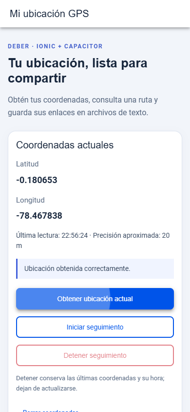
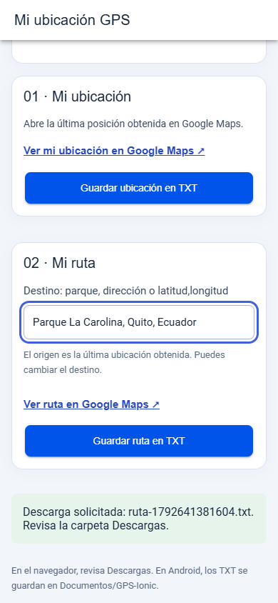

# Ubicación GPS con Ionic

Aplicación móvil desarrollada con Ionic, Angular y Capacitor. Permite obtener la ubicación del dispositivo, consultar una ruta en Google Maps y guardar ambos enlaces en archivos de texto.

## Funcionalidades

| Requisito | Implementación |
| --- | --- |
| Enlace a la posición GPS | Abre la última ubicación obtenida en Google Maps. |
| Enlace a una ruta | Genera indicaciones desde esa ubicación hasta el destino elegido. |
| Guardar ubicación en TXT | Guarda un archivo con el enlace de la posición. |
| Guardar ruta en TXT | Guarda un archivo con el enlace de las indicaciones. |

También permite iniciar y detener el seguimiento, consultar la hora y precisión de la lectura y borrar las coordenadas.

El destino inicial es **Parque La Carolina, Quito, Ecuador**. Se puede cambiar por una dirección, un lugar de interés o coordenadas en formato `latitud,longitud`.

## Tecnologías

- Ionic 9 y Angular 22.
- Capacitor 8 para la integración con Android.
- Capacitor Geolocation para obtener y actualizar la ubicación.
- Capacitor Filesystem para guardar archivos en el dispositivo.
- Google Maps URLs para consultar posiciones y rutas sin clave de API.

## Requisitos

- Node.js y npm compatibles con las versiones del proyecto. Entorno utilizado: Node.js 24.16.0 y npm 11.13.0.
- Git.
- Android Studio y SDK de Android para ejecutar la aplicación en un teléfono o emulador.
- Ubicación del dispositivo activada y permiso de acceso concedido.

El almacenamiento nativo está orientado a Android 11 o superior.

## Instalación

```cmd
git clone https://github.com/Dilanbkr7/ubicacion-gps-ionic.git
cd ubicacion-gps-ionic
npm ci
```

## Ejecutar en Android

```cmd
npm run build
npx cap sync android
npx cap open android
```

En Android Studio, selecciona un teléfono conectado por USB o un emulador y ejecuta la aplicación. Si utilizas un emulador, configura una posición desde sus controles de ubicación.

Después de modificar el código, vuelve a compilar y sincronizar antes de ejecutar Android.

## Vista de desarrollo

```cmd
npm start
```

Abre la dirección que indique la terminal, normalmente [http://localhost:4200](http://localhost:4200). La ubicación en el navegador requiere `localhost` o HTTPS y permiso de acceso al sitio.

## Uso

1. Pulsa **Obtener ubicación actual** y concede el permiso solicitado.
2. Revisa la latitud, longitud, hora de lectura y precisión aproximada.
3. Abre **Ver mi ubicación en Google Maps** para consultar la posición.
4. Escribe el destino y abre **Ver ruta en Google Maps**.
5. Utiliza los botones de guardado para generar los dos archivos TXT.

### Seguimiento de ubicación

**Iniciar seguimiento** actualiza la posición a medida que el dispositivo recibe nuevas lecturas. **Detener seguimiento** cancela las actualizaciones y conserva las últimas coordenadas para poder consultar sus enlaces.

**Borrar coordenadas** detiene el seguimiento y limpia la lectura. Salir de la página también solicita detener el seguimiento.

La aplicación muestra la posición más reciente; no almacena un historial del recorrido. Google Maps calcula la ruta hasta el destino elegido.

### Archivos TXT

Los archivos se nombran `ubicacion-<marca-de-tiempo>.txt` y `ruta-<marca-de-tiempo>.txt`. Cada uno contiene su enlace correspondiente.

- En Android se guardan en **Documentos/GPS-Ionic**.
- En la vista de desarrollo se descargan mediante el navegador.
- La pantalla muestra el resultado del guardado o el error encontrado.

## Capturas

Vistas móviles con coordenadas de prueba.

### Ubicación y seguimiento



### Ruta y archivos TXT



## Estructura del proyecto

```text
src/app/
  home/
    home.page.ts                  Acciones y estado de la pantalla
    home.page.html                Interfaz
    home.page.scss                Estilos
  services/
    location/location.service.ts  Lecturas y seguimiento de ubicación
    maps.ts                       Enlaces de Google Maps
    text-file.service.ts          Guardado de archivos TXT
android/                          Proyecto nativo
docs/capturas/                    Capturas de la aplicación
```

## Verificación

```cmd
npm run build
npm test -- --watch=false
npm run lint
```

La compilación, la revisión de código y las **19 pruebas unitarias** finalizaron correctamente. También se comprobaron los enlaces, las dos descargas TXT, la detención del seguimiento, la recuperación después de un tiempo de espera agotado y la distribución móvil.

Las pruebas de interfaz y las capturas utilizan coordenadas simuladas de Quito. La aplicación utiliza el proveedor real de ubicación del dispositivo. La recepción de ubicación real y la ejecución en un teléfono Android están pendientes de validación.

## Problemas frecuentes

| Situación | Qué revisar |
| --- | --- |
| Permiso denegado | Autorizar la ubicación en los ajustes de la aplicación o del navegador. |
| Posición no disponible | Activar la ubicación del sistema y comprobar la conexión. |
| Tiempo de espera agotado | Volver a solicitar la ubicación. La aplicación reintenta la lectura con precisión normal. |
| Las coordenadas siguen visibles al detener | Es el comportamiento previsto: dejan de actualizarse. Para eliminarlas, utilizar **Borrar coordenadas**. |

Conceder permiso no garantiza que el equipo pueda determinar su posición. La hora y la precisión mostradas permiten evaluar la lectura obtenida.

## Documentación

- [Ionic](https://ionicframework.com/docs)
- [Capacitor Geolocation](https://capacitorjs.com/docs/apis/geolocation)
- [Capacitor Filesystem](https://capacitorjs.com/docs/apis/filesystem)
- [Google Maps URLs](https://developers.google.com/maps/documentation/urls/get-started)
